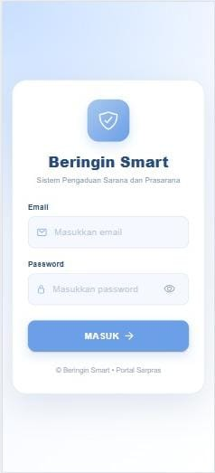
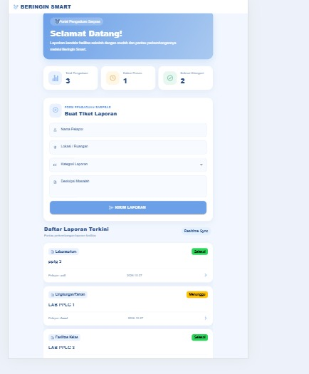
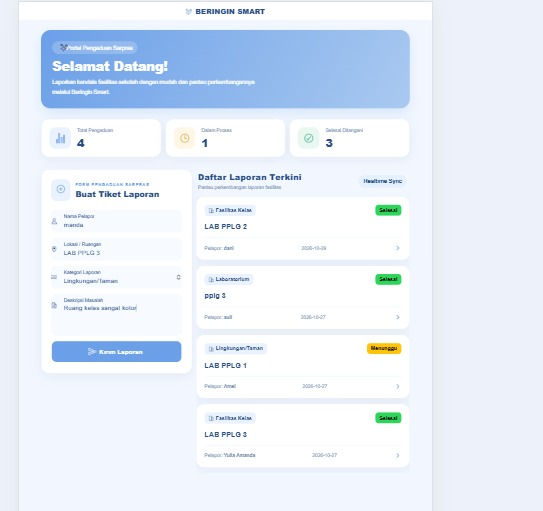
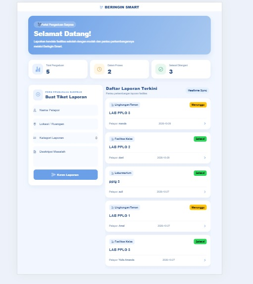
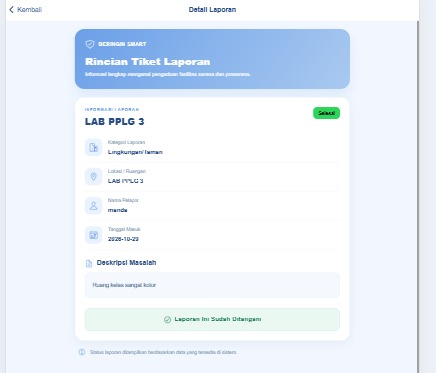
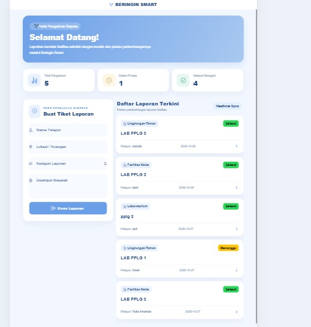
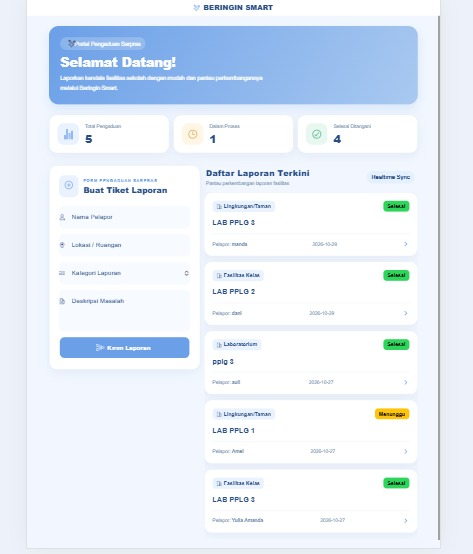
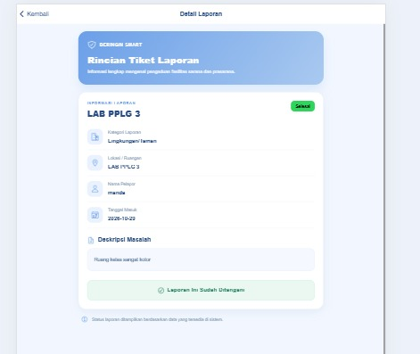

# Beringin Smart

Beringin Smart merupakan aplikasi pengaduan sarana dan prasarana berbasis web yang dikembangkan menggunakan Ionic React sebagai frontend dan Laravel sebagai backend.

## Teknologi yang Digunakan
- Frontend: Ionic React
- Backend: Laravel
- Database: MySQL

## Struktur Project
- `frontend/` — Kode aplikasi Ionic React
- `backend/` — Kode API Laravel
- `screenshots/` — Dokumentasi tampilan dan pengujian

## Dokumentasi Tampilan Aplikasi

### 1. Halaman Login

### 2. Login Siswa Berhasil

### 3. Form Pengaduan Sarana dan Prasarana

### 4. Pengujian CRUD - Create Berhasil

### 5. Detail Laporan Siswa (Read Only)

### 6. Dashboard Siswa

### 7. Login Petugas Berhasil

### 8. Detail Laporan Petugas

## Dokumentasi Pengujian Sistem

Pengujian sistem mencakup:
- Pengujian login siswa dan petugas
- Pengujian validasi login
- Pengujian tambah data pengaduan (Create)
- Pengujian hak akses siswa dan petugas
- Pengujian tampilan aplikasi

Hasil pengujian didokumentasikan dalam folder `screenshots`.
